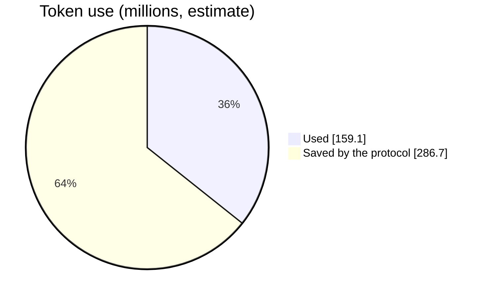
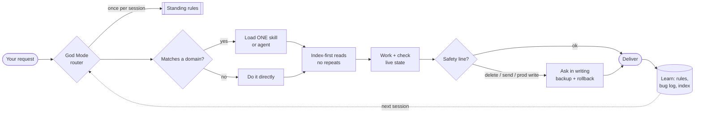
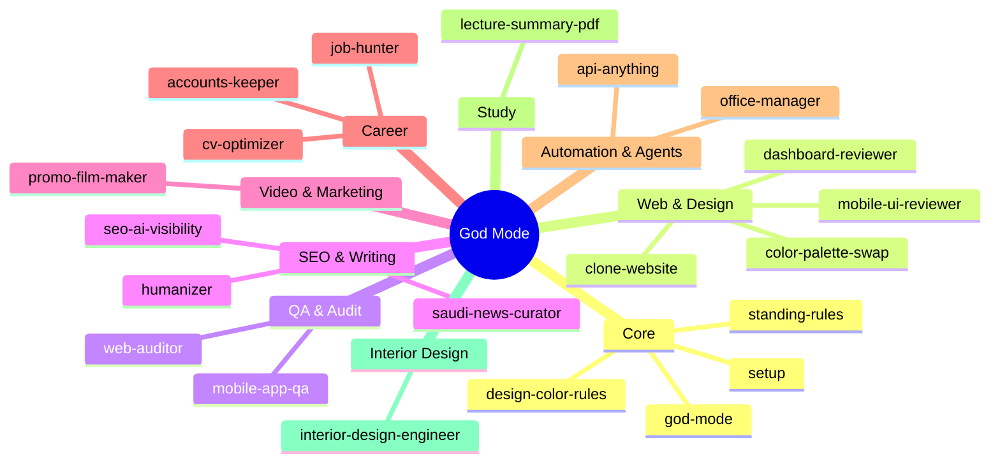

<div align="center">

# ⚡ God Mode

**A Claude Code plugin with one router skill that picks the right tool for every task. It bundles 8 skills, 9 specialist agents, 20+ standing rules and a token-saving protocol that cut token use by an estimated 64% in real work.**


[Install](#-install-one-command) · [العربية](#-بالعربي) · [Features](#-features) · [Token savings](#-token-savings) · [How it works](#-how-it-works) · [Skill map](#-skill-map)

</div>

---

## 🚀 Install (one command)

Paste one line in your terminal. It adds God Mode to Claude Code, shows the category menu (with a description and size for each), installs your picks and sets up OpenWolf:

```bash
npx kermione@godmode
```

Works on Windows, macOS and Linux (needs Node 18+). Use ↑/↓ to move, space to select, `a` for all and enter to finish. Add `--all` or `--categories gm-career,gm-video` to skip the menu.

<details>
<summary>Without Node</summary>

**macOS / Linux / Git Bash**
```bash
curl -fsSL https://raw.githubusercontent.com/Eng-Kirolos-Ehab/god-mode/main/get.sh | bash
```

**Windows PowerShell**
```powershell
irm https://raw.githubusercontent.com/Eng-Kirolos-Ehab/god-mode/main/get.ps1 | iex
```

Skip the menu with `| bash -s -- --all` or `--categories gm-career,gm-video`. The scripts are short and only call `claude plugin`, curl and npx, so [read get.sh](get.sh) first if you like.
</details>

Run it inside your project folder so OpenWolf is set up there too. The npx package source is in [`npm/kermione`](npm/kermione).

### Or from inside Claude Code

Type this inside Claude Code:

```
/plugin install god-mode --marketplace Eng-Kirolos-Ehab/god-mode
```

On older Claude Code versions, use two steps:

```
/plugin marketplace add Eng-Kirolos-Ehab/god-mode
/plugin install god-mode@god-mode
```

Or just send this to your Claude:

> Install the God Mode plugin from https://github.com/Eng-Kirolos-Ehab/god-mode

Then restart Claude Code. **In your first session, God Mode asks which categories you want** (multi-select, with a description and download size for each) and installs only those. It also sets up [OpenWolf](https://www.npmjs.com/package/openwolf) in your project automatically. Change your picks any time with `/god-mode:setup`.

### Categories

<!-- CATEGORIES:START -->
The core (20 KB) is always installed. Everything else is optional:

| # | Category | Plugin id | Size | What it does for you |
|---|---|---|---|---|
| 1 | 🎨 **Web & Design** | `gm-web-design` | 52 KB | Copy a website you like into a Next.js project, recolor a design image with a new palette, and get a scored review of a site or dashboard on a phone. |
| 2 | 🛠️ **QA & Audit** | `gm-qa-audit` | 4.3 KB | Test a mobile app before you publish it, or find out why a website is broken or slow, with a backup and rollback for every fix. |
| 3 | 📈 **SEO & Writing** | `gm-seo-writing` | 46 KB | Get found on Google and in AI answers, make AI-sounding text read like a person wrote it, and write bilingual Saudi/Gulf news articles. |
| 4 | 🎬 **Video & Marketing** | `gm-video` | 2.7 KB | Turn a product or a raw recording into a promo film, a trailer or vertical shorts with captions, plus the post and store text to go with it. *Optional video toolkit (ffmpeg, faster-whisper, video tools) ≈1 GB, offered separately and only if you say yes.* |
| 5 | 💼 **Career** | `gm-career` | 28 KB | Fix your CV and LinkedIn for ATS, check which jobs you really fit, and get a tailored CV and application drafts for each one. You send them. |
| 6 | 🤖 **Automation & Agents** | `gm-automation` | 11 KB | Pull data from a website without scraping the page, and hand a big task to a manager agent that splits it across specialists. |
| 7 | 📚 **Study** | `gm-study` | 6.0 KB | Upload a lecture and get one printable PDF: mind maps, diagrams, exam traps and a question bank with answers. |
| 8 | 🛋️ **Interior Design** | `gm-interior` | 13 KB | Plan a room from your photos and measurements: layout, furniture, lighting, a bill of quantities and a mood board. |
<!-- CATEGORIES:END -->

You can also install a category directly: `/plugin install gm-career@god-mode`.

<details>
<summary>Manual install (copy files instead of using the plugin)</summary>

```bash
git clone https://github.com/Eng-Kirolos-Ehab/god-mode.git
cd god-mode
./install.sh          # macOS / Linux / Git Bash: shows the category menu
pwsh ./install.ps1    # Windows PowerShell: shows the category menu
```
Skip the menu with `--categories gm-career,gm-video` / `-Categories gm-career,gm-video`, or install everything with `--all` / `-All`. Existing skills or agents with the same name are skipped unless you pass `--force` / `-Force`. Run it from your project folder to set up OpenWolf there, or pass `--no-openwolf` / `-NoOpenWolf` to skip it.
</details>

**What it runs on your machine:** the plugins are Markdown instructions and a few small Python helper scripts, with no MCP servers and no access to any account. The core adds **one session-start hook** ([`session-start.sh`](plugins/god-mode/hooks/session-start.sh)). It only prints a note for Claude: "setup pending", or "OpenWolf not set up in this git project". It downloads and changes nothing by itself. During setup, Claude runs `claude plugin install` for the categories you pick and `npx openwolf@2.5.3 init --agent claude` (pinned version; it keeps your existing CLAUDE.md and settings). Uninstall any time with `/plugin uninstall god-mode` and the `gm-*` plugins.

---

## 🇪🇬 بالعربي

**God Mode** هي إضافة (plugin) لـ Claude Code فيها كل المهارات والوكلاء والقواعد اللي اتعلمها Claude من شغل حقيقي: تطبيقات موبايل، مواقع، SEO، توظيف، تصميم، ومحتوى.

**التثبيت بأمر واحد في الـ terminal:**
```bash
npx kermione@godmode
```
بيشتغل على ويندوز وماك ولينكس، ومحتاج Node 18 أو أحدث. بتتحرك بالأسهم، وتختار بالـ space، وتأكد بالـ Enter.

من غير Node، ماك / لينكس / Git Bash:
```bash
curl -fsSL https://raw.githubusercontent.com/Eng-Kirolos-Ehab/god-mode/main/get.sh | bash
```
ويندوز PowerShell:
```powershell
irm https://raw.githubusercontent.com/Eng-Kirolos-Ehab/god-mode/main/get.ps1 | iex
```
الأمر ده بيضيف God Mode لـ Claude Code، ويعرض قايمة الأقسام بوصف وحجم كل قسم، وينزّل اللي تختاره، ويسطّب OpenWolf. شغّله وإنت جوه فولدر المشروع.

أو من جوه Claude Code:
```
/plugin install god-mode --marketplace Eng-Kirolos-Ehab/god-mode
```

**أول ما تفتح جلسة بعد التثبيت**، God Mode هيسألك عايز أنهي أقسام (تقدر تختار أكتر من قسم)، ومعاها وصف كل قسم وحجم تحميله، وينزّل اللي اخترته بس. وكمان بيسطّب **OpenWolf** في المشروع لوحده. تقدر تغيّر اختياراتك في أي وقت بـ `/god-mode:setup`.

- **موزّع ذكي:** بيقرأ طلبك ويختار المهارة أو الوكيل المناسب بس، من غير ما يحمّل كل حاجة.
- **قواعد ثابتة:** كل قاعدة جت من تصحيح أو مشكلة حصلت فعلًا في الشغل.
- **توفير التوكينز:** بروتوكول قراءة ذكي وفّر حوالي **287 مليون توكن (64%)** على مدار 724 جلسة.
- **أمان:** ممنوع المسح من غير إذن مكتوب، الإيميلات بتفضل مسودات، ومفيش أي حاجة بتتنفذ على بيئة حقيقية وقت الاختبار.

---

## ✨ Features

| | Feature | What it does |
|---|---|---|
| 🧭 | **Router** | Maps a request to the one skill or agent that fits, so only that one loads. |
| 📏 | **Standing rules** | 20+ rules, each from a real correction or incident ([standing-rules.md](plugins/god-mode/skills/god-mode/rules/standing-rules.md)). |
| 💰 | **Token protocol** | Index-first reading, no repeated reads, targeted search. About 64% fewer tokens. |
| 🧠 | **Learning loop** | Corrections become rules and fixed bugs go to a log, so mistakes aren't repeated. |
| 🛡️ | **Safety lines** | No deletes without written OK, messages stay drafts, no live side effects while testing, backup before production writes. |
| 🧩 | **Pick what you need** | 8 optional categories with sizes. First-run picker, change any time with `/god-mode:setup`. |
| 🤖 | **9 specialist agents** | Mobile QA, web auditor, SEO + AI visibility, promo films, job hunter, accounts keeper, two reviewers, office manager. |
| 🎨 | **Design rules** | Color harmonies, 60-30-10, OKLCH shade scales, WCAG contrast ([design-color-rules.md](plugins/god-mode/skills/god-mode/rules/design-color-rules.md)). |
| 🌍 | **Arabic + English** | Skills and triggers work in both languages. |

---

## 💰 Token savings

Measured with [OpenWolf](https://www.npmjs.com/package/openwolf) hooks across every working session from **May to November 2026**. The numbers are aggregate estimates from the ledger, produced by [`tools/token_stats.py`](tools/token_stats.py) → [`stats/token-stats.json`](stats/token-stats.json).

| Metric | Value |
|---|---:|
| Tokens used | **159.1 M** |
| Tokens saved (estimate vs. plain Claude Code) | **286.7 M** |
| Would have used without the protocol | 445.8 M |
| **Reduction** | **≈ 64.3 %** |
| Work sessions | 724 |
| File reads / writes | 48,624 / 71,861 |
| Repeated reads blocked | **28,888** |
| Index hit rate (answered without opening the file) | 42.3 % |



| Month | Tokens (M) | Repeated reads blocked |
|---|---:|---:|
| 2026-05 | 6.8 | 1,382 |
| 2026-06 | 30.1 | 4,861 |
| 2026-07 | 48.0 | 11,469 |
| 2026-08 | 35.1 | 4,945 |
| 2026-09 | 4.1 | 659 |
| 2026-10 | 15.6 | 723 |
| 2026-11* | 19.4 | 4,849 |

<sub>*partial month. "Saved" is OpenWolf's estimate of what reading without an index and a repeat-read guard would have cost. It isn't a billing figure, and your savings depend on your projects.</sub>

### Where the savings come from
1. **Index before reading.** A short description of each file answers most questions without opening it.
2. **No repeated reads.** A file that hasn't changed is never read twice (28,888 blocked).
3. **Targeted search.** Grep for the symbol and read only those lines.
4. **One skill at a time.** The router loads one specialist, not the whole collection.
5. **Media stays in scripts.** Images, PDFs and video frames never enter the context.
6. **Known fixes first.** Check the bug log before debugging again.

> Want the same numbers for your own work? Install [OpenWolf](https://www.npmjs.com/package/openwolf), work as usual, then run `python tools/token_stats.py .wolf/token-ledger.json`.

---

## 🔁 How it works



1. **Route.** Pick one row from the router table in [`plugins/god-mode/skills/god-mode/SKILL.md`](plugins/god-mode/skills/god-mode/SKILL.md).
2. **Rules.** Load the standing rules once per session.
3. **Work cheaply.** Index first, targeted search, parallel tool calls, no repeated reads.
4. **Verify.** Check the live state (git remote, deployed version, DB value) before changing anything.
5. **Guard.** Deletes, sends and production writes need written OK, a backup and a rollback.
6. **Learn.** Corrections become rules, and bugs go to the log.

---

## 🗺️ Skill map

What each one does, what to say to use it, and what it will ask you first.

<!-- SKILLMAP:START -->



<details open>
<summary><b>🧭 Core (always installed) · 20 KB</b></summary>

| Name | Type | Say something like | You get | It asks you for |
|---|---|---|---|---|
| [god-mode](plugins/god-mode/skills/god-mode) | skill | "/god-mode build me a landing page" | Picks the one skill or agent that fits and applies the working rules and token protocol | nothing |
| [setup](plugins/god-mode/skills/setup) | skill | "/god-mode:setup" | The category picker: add or remove categories | which categories you want |
| [standing-rules](plugins/god-mode/skills/god-mode/rules/standing-rules.md) | rules | "(loaded automatically)" | Safety and quality rules: no deletes without OK, drafts not sends, backups before production writes | nothing |
| [design-color-rules](plugins/god-mode/skills/god-mode/rules/design-color-rules.md) | rules | "pick a palette for my app" | Harmonies, 60-30-10, OKLCH shade scales, WCAG contrast checks | your brand color, if any |
</details>

<details>
<summary><b>🎨 Web & Design · 52 KB</b> (<code>gm-web-design</code>)</summary>

Copy a website you like into a Next.js project, recolor a design image with a new palette, and get a scored review of a site or dashboard on a phone.

| Name | Type | Say something like | You get | It asks you for |
|---|---|---|---|---|
| [clone-website](plugins/gm-web-design/skills/clone-website) | skill | "clone https://example.com into Next.js" | A working Next.js copy, built section by section with its assets and styles | the URL(s), and whether you own the site or have the right to copy it |
| [color-palette-swap](plugins/gm-web-design/skills/color-palette-swap) | skill | "recolor this design with this palette (attach both images)" | Two recolored PNGs: a light-to-light match and an aesthetic alternative | the design file (PSD/PNG/JPG) and the palette image |
| [mobile-ui-reviewer](plugins/gm-web-design/agents/mobile-ui-reviewer.md) | agent | "review my site on mobile" | Scores per area plus exact CSS/HTML fixes, checked at 360–430px | the URL, which pages, and whether to fix or only report |
| [dashboard-reviewer](plugins/gm-web-design/agents/dashboard-reviewer.md) | agent | "review my admin dashboard" | Scores and the top 3 fixes for layout, data correctness and design consistency | the URL or screenshots, and who uses it for what |
</details>

<details>
<summary><b>🛠️ QA & Audit · 4.3 KB</b> (<code>gm-qa-audit</code>)</summary>

Test a mobile app before you publish it, or find out why a website is broken or slow, with a backup and rollback for every fix.

| Name | Type | Say something like | You get | It asks you for |
|---|---|---|---|---|
| [mobile-app-qa](plugins/gm-qa-audit/agents/mobile-app-qa.md) | agent | "test this build before I upload it" | A bug report with steps and evidence, and a GO / NO-GO verdict | the app, the platforms, what changed, and a test server and account |
| [web-auditor](plugins/gm-qa-audit/agents/web-auditor.md) | agent | "my site is stuck loading / shows 500" | Cause, fix, proof it works, and the rollback command | the URL, the symptom, where the code is, and whether to fix or only report |
</details>

<details>
<summary><b>📈 SEO & Writing · 46 KB</b> (<code>gm-seo-writing</code>)</summary>

Get found on Google and in AI answers, make AI-sounding text read like a person wrote it, and write bilingual Saudi/Gulf news articles.

| Name | Type | Say something like | You get | It asks you for |
|---|---|---|---|---|
| [seo-ai-visibility](plugins/gm-seo-writing/agents/seo-ai-visibility.md) | agent | "why isn't my site showing on Google or in ChatGPT?" | A ranked fix list: robots, sitemap, llms.txt, schema, hreflang, speed | the site URL, languages, the pages that matter, and whether to allow AI crawlers |
| [humanizer](plugins/gm-seo-writing/skills/humanizer) | skill | "make this sound less like AI (paste text)" | The same text with AI tells removed and every fact kept | nothing beyond the text |
| [saudi-news-curator](plugins/gm-seo-writing/skills/saudi-news-curator) | skill | "هات تريند السعودية النهارده and write an SEO article" | A verified Arabic + English article with SEO title, meta and hashtags | your site URL (once) and the topic or section |
</details>

<details>
<summary><b>🎬 Video & Marketing · 2.7 KB</b> (<code>gm-video</code>)</summary>

Turn a product or a raw recording into a promo film, a trailer or vertical shorts with captions, plus the post and store text to go with it.

| Name | Type | Say something like | You get | It asks you for |
|---|---|---|---|---|
| [promo-film-maker](plugins/gm-video/agents/promo-film-maker.md) | agent | "make a 30-second promo for my app" | A storyboard to approve, the rendered video, then caption, hashtags and store text | the product, the platform (9:16 or 16:9), length, language, and the one message to remember |
</details>

<details>
<summary><b>💼 Career · 28 KB</b> (<code>gm-career</code>)</summary>

Fix your CV and LinkedIn for ATS, check which jobs you really fit, and get a tailored CV and application drafts for each one. You send them.

| Name | Type | Say something like | You get | It asks you for |
|---|---|---|---|---|
| [cv-optimizer](plugins/gm-career/skills/cv-optimizer) | skill | "analyze my CV for this job (paste both)" | Line-by-line fixes, an ATS keyword check, and before/after rewrites | your full CV, the job description, years, top achievements with numbers, and your target market |
| [job-hunter](plugins/gm-career/agents/job-hunter.md) | agent | "apply to this job (paste the post)" | A fit verdict, a tailored CV, form answers and an email draft, logged | your profile once (CV, skills, roles, locations, salary range) and any number it can't find |
| [accounts-keeper](plugins/gm-career/agents/accounts-keeper.md) | agent | "which job sites am I registered on?" | A registry of your job-site accounts and their status | which sites, and which Google account to use. You type passwords and codes |
</details>

<details>
<summary><b>🤖 Automation & Agents · 11 KB</b> (<code>gm-automation</code>)</summary>

Pull data from a website without scraping the page, and hand a big task to a manager agent that splits it across specialists.

| Name | Type | Say something like | You get | It asks you for |
|---|---|---|---|---|
| [api-anything](plugins/gm-automation/skills/api-anything) | skill | "get the flight prices from A to B on <site>" | The data straight from the site's own requests, or a reusable operation | the site and what you want from it; you sign in yourself |
| [office-manager](plugins/gm-automation/agents/office-manager.md) | agent | "someone handle the launch checklist" | The task split across the right agents, with a combined report | one question at most, when a decision is yours |
</details>

<details>
<summary><b>📚 Study · 6.0 KB</b> (<code>gm-study</code>)</summary>

Upload a lecture and get one printable PDF: mind maps, diagrams, exam traps and a question bank with answers.

| Name | Type | Say something like | You get | It asks you for |
|---|---|---|---|---|
| [lecture-summary-pdf](plugins/gm-study/skills/lecture-summary-pdf) | skill | "لخّص المحاضرة دي (attach the PDF)" | An A4 summary PDF with mind maps, diagrams, exam traps, MCQ + True/False and an answer key | how many questions, whether you want a recap in your language, and pages to skip |
</details>

<details>
<summary><b>🛋️ Interior Design · 13 KB</b> (<code>gm-interior</code>)</summary>

Plan a room from your photos and measurements: layout, furniture, lighting, a bill of quantities and a mood board.

| Name | Type | Say something like | You get | It asks you for |
|---|---|---|---|---|
| [interior-design-engineer](plugins/gm-interior/skills/interior-design-engineer) | skill | "design my living room 4×5 m (attach photos)" | Layout options, furniture and lighting plan, BOQ, and a mood board | room photos and measurements, inspiration images, budget and style |
</details>
<!-- SKILLMAP:END -->

---

## 📁 Layout

```
god-mode/
├── .claude-plugin/marketplace.json   # lists the core + 8 categories
├── plugins/
│   ├── god-mode/            # core: router (SKILL.md + rules/), setup, session hook
│   └── gm-*/                # 8 optional categories (skills + agents)
├── categories.json          # category names and descriptions (source of truth)
├── catalog.generated.*      # sizes and contents, built by tools/build_catalog.py
├── tools/                   # build_catalog.py, token_stats.py
├── stats/token-stats.json
├── EXTERNAL_SKILLS.md
├── CHANGELOG.md
├── get.sh / get.ps1         # one-line installers (curl | bash, irm | iex)
├── npm/kermione/               # the `npx kermione@godmode` installer
└── install.sh / install.ps1 # manual install
```

## 📜 License

MIT. `humanizer` (© Siqi Chen) and `api-anything` (© Tianjun Zheng) are MIT-licensed third-party skills and keep their own LICENSE files.

<div align="center"><sub>Built by <a href="https://github.com/Eng-Kirolos-Ehab">Kirolos Ehab</a> with Claude Code.</sub></div>
