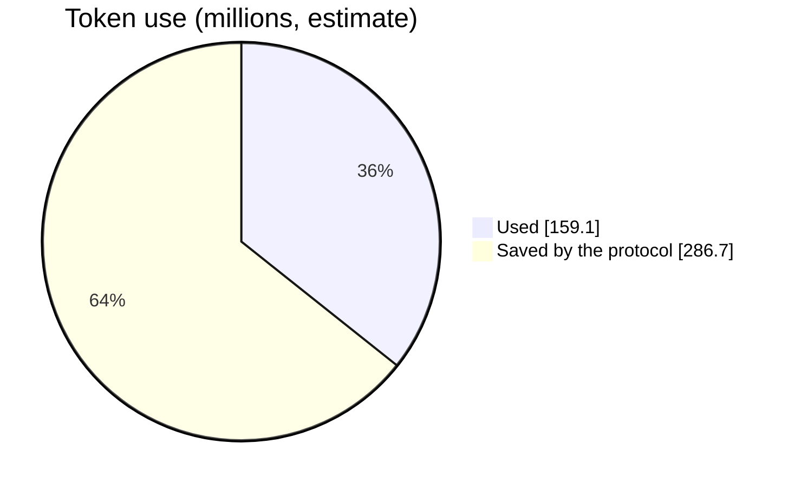
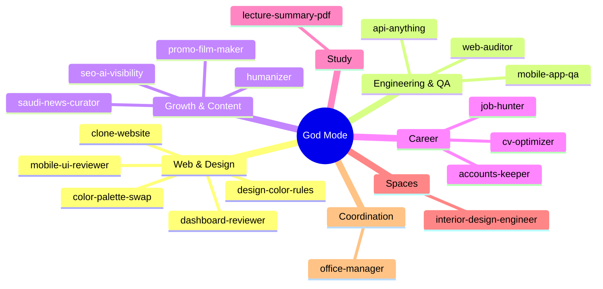

<div align="center">

# ⚡ God Mode

**A Claude Code plugin with one router skill that picks the right tool for every task. It bundles 8 skills, 9 specialist agents, 20+ standing rules and a token-saving protocol that cut token use by an estimated 64% in real work.**


[Install](#-install-one-command) · [العربية](#-بالعربي) · [Features](#-features) · [Token savings](#-token-savings) · [How it works](#-how-it-works) · [Skill map](#-skill-map)

</div>

---

## 🚀 Install (one command)

Type this inside Claude Code:

```
/plugin install god-mode --marketplace Eng-Kirolos-Ehab/god-mode
```

On older Claude Code versions, use two steps:

```
/plugin marketplace add Eng-Kirolos-Ehab/god-mode
/plugin install god-mode@god-mode
```

Or just send this to your Claude:

> Install the God Mode plugin from https://github.com/Eng-Kirolos-Ehab/god-mode

Then restart Claude Code. **In your first session, God Mode asks which categories you want** (multi-select, with a description and download size for each) and installs only those. It also sets up [OpenWolf](https://www.npmjs.com/package/openwolf) in your project automatically. Change your picks any time with `/god-mode:setup`.

### Categories

The core (19 KB) is always installed: router, standing rules, token protocol and setup. Everything else is optional:

| # | Category | Plugin id | Size | What you get |
|---|---|---|---|---|
| 1 | **Web & Design** | `gm-web-design` | 51 KB | Clone a website into Next.js, swap a color palette across a codebase, and two reviewers for phone-width pages and dashboards. |
| 2 | **QA & Audit** | `gm-qa-audit` | 3.5 KB | Agents that test a mobile app before a store build and find why a site is broken or slow (CORS, 500s, routes). |
| 3 | **SEO & Writing** | `gm-seo-writing` | 46 KB | SEO and AI-crawler visibility audits, rewrite text that sounds like AI, and bilingual Arabic/English news articles. |
| 4 | **Video & Marketing** | `gm-video` | 2.7 KB | Promo films, trailers, shorts and captions with launch copy. Picks the right video tool for each job. *Optional video toolkit (ffmpeg, faster-whisper, video tools) ≈1 GB, offered separately and only if you say yes.* |
| 5 | **Career** | `gm-career` | 28 KB | CV and LinkedIn optimizer, an ATS-aware job hunter that tailors a CV per job, and a job-site accounts registry. |
| 6 | **Automation & Agents** | `gm-automation` | 11 KB | Get data from websites through their own requests, and an office-manager agent that splits big tasks across specialists. |
| 7 | **Study** | `gm-study` | 5.3 KB | Turn a lecture PDF into a designed A4 study summary with mind maps, diagrams and exam questions. |
| 8 | **Interior Design** | `gm-interior` | 13 KB | Room layouts, furniture plans, bills of quantities and mood boards. |

You can also install a category directly: `/plugin install gm-career@god-mode`.

<details>
<summary>Manual install (copy files instead of using the plugin)</summary>

```bash
git clone https://github.com/Eng-Kirolos-Ehab/god-mode.git
cd god-mode
./install.sh          # macOS / Linux / Git Bash: shows the category menu
pwsh ./install.ps1    # Windows PowerShell: shows the category menu
```
Skip the menu with `--categories gm-career,gm-video` / `-Categories gm-career,gm-video`, or install everything with `--all` / `-All`. Existing skills or agents with the same name are skipped unless you pass `--force` / `-Force`. Run it from your project folder to set up OpenWolf there, or pass `--no-openwolf` / `-NoOpenWolf` to skip it.
</details>

**What it runs on your machine:** the plugins are Markdown instructions and a few small Python helper scripts, with no MCP servers and no access to any account. The core adds **one session-start hook** ([`session-start.sh`](plugins/god-mode/hooks/session-start.sh)). It only prints a note for Claude: "setup pending", or "OpenWolf not set up in this git project". It downloads and changes nothing by itself. During setup, Claude runs `claude plugin install` for the categories you pick and `npx openwolf@2.5.3 init --agent claude` (pinned version; it keeps your existing CLAUDE.md and settings). Uninstall any time with `/plugin uninstall god-mode` and the `gm-*` plugins.

---

## 🇪🇬 بالعربي

**God Mode** هي إضافة (plugin) لـ Claude Code فيها كل المهارات والوكلاء والقواعد اللي اتعلمها Claude من شغل حقيقي: تطبيقات موبايل، مواقع، SEO، توظيف، تصميم، ومحتوى.

**التثبيت:** ابعت لـ Claude بتاعك الأمر ده:
```
/plugin install god-mode --marketplace Eng-Kirolos-Ehab/god-mode
```

**أول ما تفتح جلسة بعد التثبيت**، God Mode هيسألك عايز أنهي أقسام (تقدر تختار أكتر من قسم)، ومعاها وصف كل قسم وحجم تحميله، وينزّل اللي اخترته بس. وكمان بيسطّب **OpenWolf** في المشروع لوحده. تقدر تغيّر اختياراتك في أي وقت بـ `/god-mode:setup`.

- **موزّع ذكي:** بيقرأ طلبك ويختار المهارة أو الوكيل المناسب بس، من غير ما يحمّل كل حاجة.
- **قواعد ثابتة:** كل قاعدة جت من تصحيح أو مشكلة حصلت فعلًا في الشغل.
- **توفير التوكينز:** بروتوكول قراءة ذكي وفّر حوالي **287 مليون توكن (64%)** على مدار 724 جلسة.
- **أمان:** ممنوع المسح من غير إذن مكتوب، الإيميلات بتفضل مسودات، ومفيش أي حاجة بتتنفذ على بيئة حقيقية وقت الاختبار.

---

## ✨ Features

| | Feature | What it does |
|---|---|---|
| 🧭 | **Router** | Maps a request to the one skill or agent that fits, so only that one loads. |
| 📏 | **Standing rules** | 20+ rules, each from a real correction or incident ([standing-rules.md](plugins/god-mode/skills/god-mode/rules/standing-rules.md)). |
| 💰 | **Token protocol** | Index-first reading, no repeated reads, targeted search. About 64% fewer tokens. |
| 🧠 | **Learning loop** | Corrections become rules and fixed bugs go to a log, so mistakes aren't repeated. |
| 🛡️ | **Safety lines** | No deletes without written OK, messages stay drafts, no live side effects while testing, backup before production writes. |
| 🧩 | **Pick what you need** | 8 optional categories with sizes. First-run picker, change any time with `/god-mode:setup`. |
| 🤖 | **9 specialist agents** | Mobile QA, web auditor, SEO + AI visibility, promo films, job hunter, accounts keeper, two reviewers, office manager. |
| 🎨 | **Design rules** | Color harmonies, 60-30-10, OKLCH shade scales, WCAG contrast ([design-color-rules.md](plugins/god-mode/skills/god-mode/rules/design-color-rules.md)). |
| 🌍 | **Arabic + English** | Skills and triggers work in both languages. |

---

## 💰 Token savings

Measured with [OpenWolf](https://www.npmjs.com/package/openwolf) hooks across every working session from **May to November 2026**. The numbers are aggregate estimates from the ledger, produced by [`tools/token_stats.py`](tools/token_stats.py) → [`stats/token-stats.json`](stats/token-stats.json).

| Metric | Value |
|---|---:|
| Tokens used | **159.1 M** |
| Tokens saved (estimate vs. plain Claude Code) | **286.7 M** |
| Would have used without the protocol | 445.8 M |
| **Reduction** | **≈ 64.3 %** |
| Work sessions | 724 |
| File reads / writes | 48,624 / 71,861 |
| Repeated reads blocked | **28,888** |
| Index hit rate (answered without opening the file) | 42.3 % |



| Month | Tokens (M) | Repeated reads blocked |
|---|---:|---:|
| 2026-05 | 6.8 | 1,382 |
| 2026-06 | 30.1 | 4,861 |
| 2026-07 | 48.0 | 11,469 |
| 2026-08 | 35.1 | 4,945 |
| 2026-09 | 4.1 | 659 |
| 2026-10 | 15.6 | 723 |
| 2026-11* | 19.4 | 4,849 |

<sub>*partial month. "Saved" is OpenWolf's estimate of what reading without an index and a repeat-read guard would have cost. It isn't a billing figure, and your savings depend on your projects.</sub>

### Where the savings come from
1. **Index before reading.** A short description of each file answers most questions without opening it.
2. **No repeated reads.** A file that hasn't changed is never read twice (28,888 blocked).
3. **Targeted search.** Grep for the symbol and read only those lines.
4. **One skill at a time.** The router loads one specialist, not the whole collection.
5. **Media stays in scripts.** Images, PDFs and video frames never enter the context.
6. **Known fixes first.** Check the bug log before debugging again.

> Want the same numbers for your own work? Install [OpenWolf](https://www.npmjs.com/package/openwolf), work as usual, then run `python tools/token_stats.py .wolf/token-ledger.json`.

---

## 🔁 How it works


1. **Route.** Pick one row from the router table in [`plugins/god-mode/skills/god-mode/SKILL.md`](plugins/god-mode/skills/god-mode/SKILL.md).
2. **Rules.** Load the standing rules once per session.
3. **Work cheaply.** Index first, targeted search, parallel tool calls, no repeated reads.
4. **Verify.** Check the live state (git remote, deployed version, DB value) before changing anything.
5. **Guard.** Deletes, sends and production writes need written OK, a backup and a rollback.
6. **Learn.** Corrections become rules, and bugs go to the log.

---

## 🗺️ Skill map



<details open>
<summary><b>🎨 Web & Design</b></summary>

| Name | Type | Use it for |
|---|---|---|
| [clone-website](plugins/gm-web-design/skills/clone-website) | skill | Rebuild an existing site section by section (assets, CSS, content) in Next.js |
| [color-palette-swap](plugins/gm-web-design/skills/color-palette-swap) | skill | Swap a color palette across a whole codebase safely |
| [design-color-rules](plugins/god-mode/skills/god-mode/rules/design-color-rules.md) | rules | Harmonies, 60-30-10, OKLCH scales, contrast |
| [mobile-ui-reviewer](plugins/gm-web-design/agents/mobile-ui-reviewer.md) | agent | Phone-width review: layout, touch, type, contrast, motion, speed |
| [dashboard-reviewer](plugins/gm-web-design/agents/dashboard-reviewer.md) | agent | Critical review of admin, analytics or smart-home dashboards |
</details>

<details>
<summary><b>🛠️ Engineering & QA</b></summary>

| Name | Type | Use it for |
|---|---|---|
| [mobile-app-qa](plugins/gm-qa-audit/agents/mobile-app-qa.md) | agent | App QA on Android/iOS, misuse scenarios, GO/NO-GO bug reports |
| [web-auditor](plugins/gm-qa-audit/agents/web-auditor.md) | agent | Stuck loaders, CORS, 500s, slow pages, fixed with backup + rollback |
| [api-anything](plugins/gm-automation/skills/api-anything) | skill (MIT) | Get data from a site through its own requests |
</details>

<details>
<summary><b>📈 Growth & Content</b></summary>

| Name | Type | Use it for |
|---|---|---|
| [seo-ai-visibility](plugins/gm-seo-writing/agents/seo-ai-visibility.md) | agent | SEO + AI-crawler visibility: robots, llms.txt, schema, hreflang |
| [promo-film-maker](plugins/gm-video/agents/promo-film-maker.md) | agent | Promo films made in code + launch copy |
| [humanizer](plugins/gm-seo-writing/skills/humanizer) | skill (MIT) | Remove AI tells from writing |
| [saudi-news-curator](plugins/gm-seo-writing/skills/saudi-news-curator) | skill | Verified bilingual Saudi/Gulf news articles with SEO and hashtags |
</details>

<details>
<summary><b>💼 Career</b></summary>

| Name | Type | Use it for |
|---|---|---|
| [cv-optimizer](plugins/gm-career/skills/cv-optimizer) | skill | CV + LinkedIn analysis, ATS, interview prep (Arabic + English) |
| [job-hunter](plugins/gm-career/agents/job-hunter.md) | agent | Find jobs, honest fit check, tailored CV + researched company note |
| [accounts-keeper](plugins/gm-career/agents/accounts-keeper.md) | agent | Job-site accounts registry. Never touches passwords |
</details>

<details>
<summary><b>📚 Study, Spaces & Coordination</b></summary>

| Name | Type | Use it for |
|---|---|---|
| [lecture-summary-pdf](plugins/gm-study/skills/lecture-summary-pdf) | skill | Lecture PDF to an A4 summary with mind maps and MCQs |
| [interior-design-engineer](plugins/gm-interior/skills/interior-design-engineer) | skill | Room design, furniture plans, BOQ |
| [office-manager](plugins/gm-automation/agents/office-manager.md) | agent | Splits broad tasks across the right specialists |
</details>

Recommended companions (not bundled, each under its own license): see [EXTERNAL_SKILLS.md](EXTERNAL_SKILLS.md).

---

## 📁 Layout

```
god-mode/
├── .claude-plugin/marketplace.json   # lists the core + 8 categories
├── plugins/
│   ├── god-mode/            # core: router (SKILL.md + rules/), setup, session hook
│   └── gm-*/                # 8 optional categories (skills + agents)
├── categories.json          # category names and descriptions (source of truth)
├── catalog.generated.*      # sizes and contents, built by tools/build_catalog.py
├── tools/                   # build_catalog.py, token_stats.py
├── stats/token-stats.json
├── EXTERNAL_SKILLS.md
├── CHANGELOG.md
└── install.sh / install.ps1 # manual install
```

## 📜 License

MIT. `humanizer` (© Siqi Chen) and `api-anything` (© Tianjun Zheng) are MIT-licensed third-party skills and keep their own LICENSE files.

<div align="center"><sub>Built by <a href="https://github.com/Eng-Kirolos-Ehab">Kirolos Ehab</a> with Claude Code.</sub></div>
